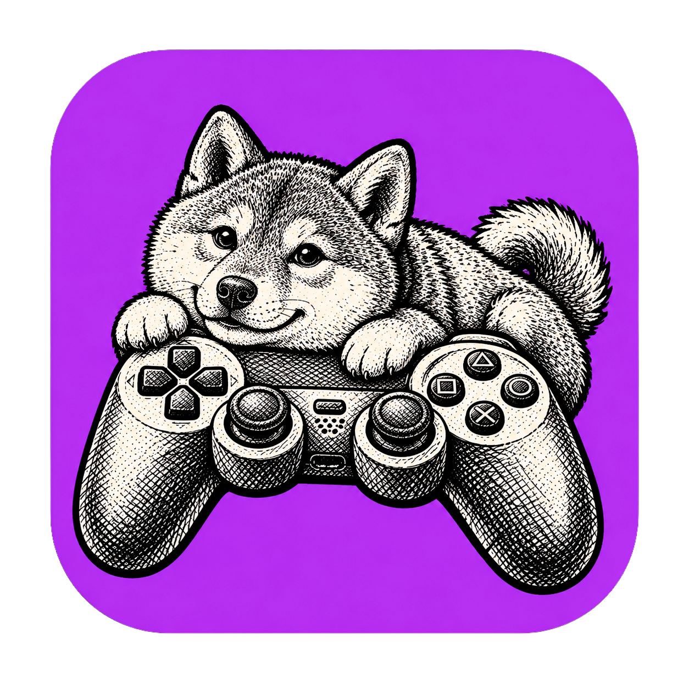

# GameCraft



Beginner-friendly visual game creation: place objects, adjust properties, connect logic, press Play.

```bash
npm install
npm run dev      # http://localhost:5173
npm test         # plays every template headlessly and checks its mechanics
npm run build    # production bundle in dist/ (serve with npm run preview so the project API is available)
```

## Source map

| Path | What |
|---|---|
| `src/engine/sceneView.ts` | three.js scene built from SceneData (edit) or runtime instances (play) |
| `src/engine/blenderStyle.ts` | Blender light units and camera lens/shift/clip conversion |
| `src/engine/postfx.ts` | Post-processing pipeline and shaders (PS1, Pixel Art, CRT, VHS, …) |
| `src/engine/particlesView.ts` | GPU point-sprite rendering of shared particle emitters |
| `src/engine/assets.ts`, `thumbnails.ts` | OBJ/MTL, glTF, FBX loading, normalization, thumbnails |
| `src/engine/play.ts`, `hud.ts`, `audio.ts` | Play-in-editor session, HUD overlay, synthesized audio |
| `src/editor/*` | Editor shell, viewport (G/R/S modal transforms, gizmo), outliner, inspector, effects, logic, assets, import wizard, animation, particles, console/debug, tutorial |
| `src/project/*` | Project format, migration, API client, store with undo/redo and autosave |
| `src/templates/*` | 8 starter templates (+ empty 2D/3D) |
| `Assets/` | Your supplied models (Coin, Gun, LowPolyHuman, LowPolyTruck, Shovel, Start_Finish, Sword) |
| `asset-library/` | Backrooms textures/icons and the Dungeon Bound pixel font (copied from your E: drive folders) |
| `projects/` | Saved projects (created at runtime) |

Templates: Truck Coin Collector, 3D Platformer, 2D Side Scroller, Physics Playground, Combat Arena, Digging
Treasure Hunt, Dungeon Bound, Backrooms. See ../docs/USER_GUIDE.md.
