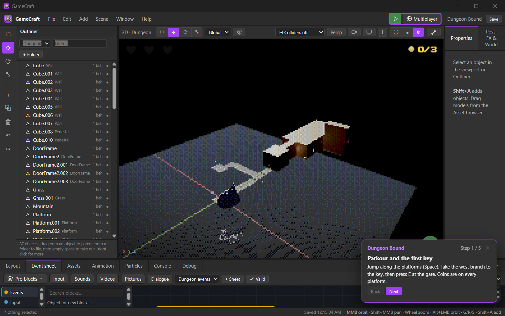
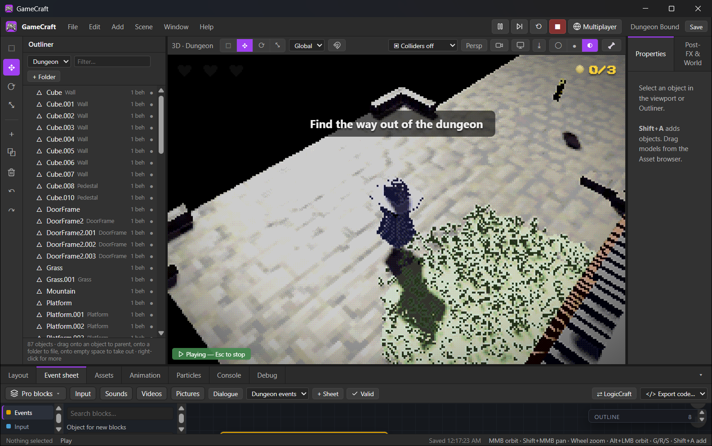
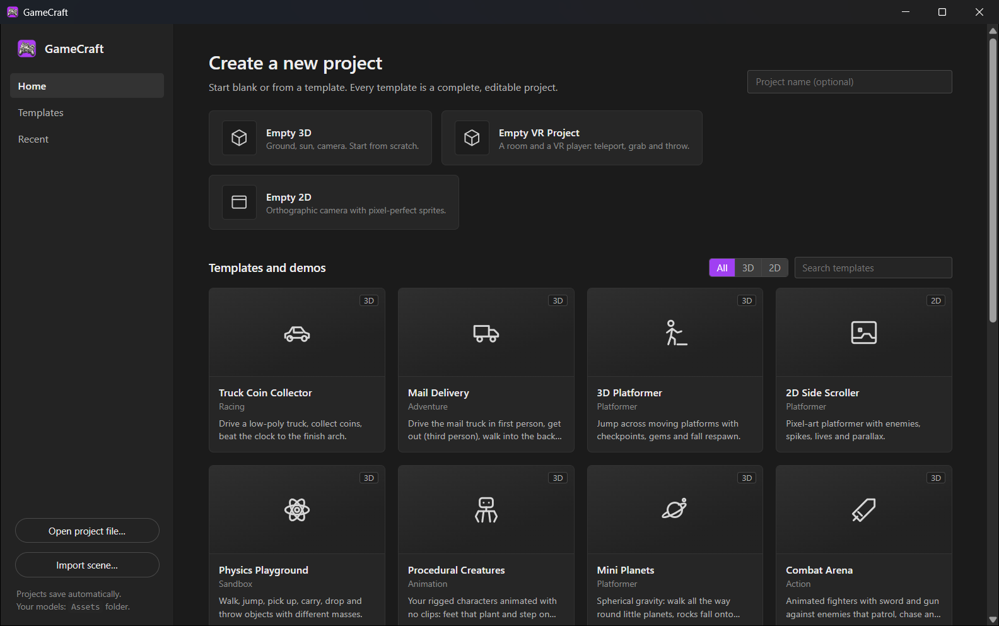

# GameCraft

**A visual game editor: build 3D and 2D games with event sheets or blocks, and press Play.**

GameCraft is a visual game editor. Place objects in a 3D or 2D scene, set them up with Blender-style lights,
cameras and materials, and give them behavior with Construct-style event sheets or Scratch-style blocks
(the same logic, two views). Press Play to test instantly.



## Download

Get the latest version from the [Releases page](https://github.com/VibeCodedSoftware/GameCraft/releases/latest):

| File | What it is |
|---|---|
| `GameCraft-1.0.0-setup.exe` | **Recommended.** Installs for your Windows account (no administrator rights), adds Start menu and desktop shortcuts, and can be removed from *Settings › Apps*. |
| `GameCraft-1.0.0-windows-x64.zip` | Portable. Unzip anywhere and run `GameCraft.exe` (keep the folders beside it). |

Windows 10 or 11, 64-bit. The program isn't code-signed yet, so Windows SmartScreen may warn the first
time: choose **More info › Run anyway**.

## Start

* **Create a new project** from Blank 3D / Blank 2D, or from a template or demo. Every template is a complete,
  editable game with a step-by-step tutorial.
* Projects save automatically to `%LOCALAPPDATA%\CraftApps\GameCraft\projects` (Ctrl+S saves now).
* **Play / Stop**: the Play button or F5. Mouse-look games capture the mouse when you press Play;
  **Esc** releases it, Esc again stops the game.

## Templates and demos

| Template | What it shows |
|---|---|
| Truck Coin Collector | Car behavior, collectibles, timer, finish line |
| 3D Platformer | Animated character, moving platforms, checkpoints |
| 2D Side Scroller | Pixel-art sprites, enemies, lives, parallax |
| Physics Playground | Carry, drop and throw objects with mass |
| Combat Arena | Animated fighters, sword and gun, pathfinding AI |
| Arms Shooter | First person with the LowPolyArms model, hitscan weapons, enemy waves |
| Digging Treasure Hunt | First-person voxel terrain you can dig and build, buried treasure |
| Dungeon Bound | A level made in Blender (.blend) with a wizard character, keys, levers, traps |
| Backrooms | First-person infinite rooms from a .blend, survival, inventory (Tab), building, a monster |

## Your own assets

* **Import** (Assets panel): `.blend` files open directly (no Blender needed) — choose which objects to import.
  Also `.glb/.gltf`, `.fbx`, `.obj` (+ `.mtl`), images, audio and fonts.
* Models placed in the `Assets` folder next to the program appear under Assets › Library.

## Logic

Event sheets and blocks edit the same logic. Logic can be sent to and from **LogicCraft** (the companion
visual-programming app) and exported as JavaScript, Python, Lua, C# or C++.

## Folders

* `GameCraft.exe` — the application.
* `Assets` — your models (shown in the asset library).
* `asset-library` — models, textures, fonts and animations used by the templates.

See `NOTICE.md` for credits and third-party licences.





## Build from source

Needs [Node.js](https://nodejs.org/) 20 or later and [Rust](https://rustup.rs/) (stable, MSVC toolchain on
Windows). This repository holds the app together with the shared code it uses (`Shared/`), plus the Blender export add-on (`Blender/craft_export`).

```powershell
powershell -ExecutionPolicy Bypass -File build.ps1
```

`build.ps1` installs the npm packages, builds the interface, compiles the desktop program and writes the
portable folder to `Windows\GameCraft` and the zip to `public\`. For a development server with hot reload,
run `npm run dev` in `GameCraft\`.

## License

GameCraft is licensed under **MIT OR Apache-2.0** ([LICENSE-MIT](GameCraft/LICENSE-MIT),
[LICENSE-APACHE](GameCraft/LICENSE-APACHE)). Third-party code and assets are credited in
[NOTICE.md](packaging/GameCraft/NOTICE.md) and [THIRD_PARTY_NOTICES.md](THIRD_PARTY_NOTICES.md).
